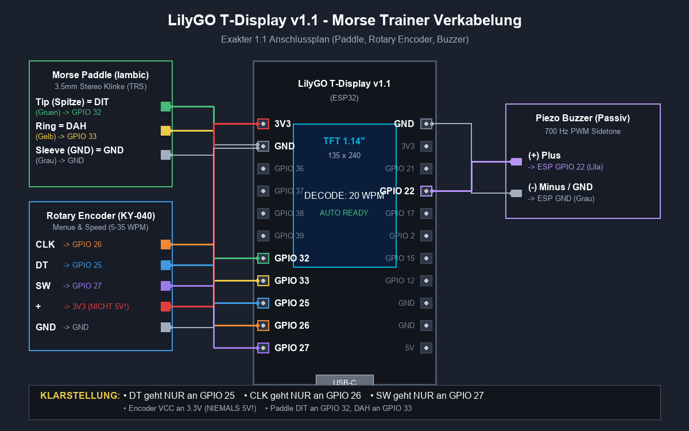

# 📻 ESP32 Iambic Morse-Trainer & Decoder

[🇬🇧 English](README.md) · **🇩🇪 Deutsch**

[](https://github.com/DF3MT/esp32-morse-trainer/actions/workflows/build-and-deploy.yml)
[](https://df3mt.github.io/esp32-morse-trainer/)
[](https://github.com/DF3MT/esp32-morse-trainer/releases/tag/latest)
[](https://www.lilygo.cc/)
[]()
[]()
[](LICENSE)

Ein eigenständiger **CW-Morse-Trainer, Iambic-Keyer und Echtzeit-Decoder** für das **LilyGO T-Display v1.1** (ESP32 mit eingebautem 1,14"-IPS-Farbdisplay).

Gedacht für Funkamateure, die ihr CW bis 40 WPM verbessern wollen, und für Einsteiger, die Morsen mit der **Koch-Methode** von Grund auf lernen.

> ⚡ **Installation im Browser:** Firmware per Mausklick flashen, ohne Software-Installation: [**DF3MT Web Flasher**](https://df3mt.github.io/esp32-morse-trainer/) (Chrome, Edge oder Opera am Desktop).

---

## 📚 Dokumentation

| Dokument | English | Deutsch |
|---|---|---|
| Überblick, Funktionen, Bedienung | [README.md](README.md) | diese Datei |
| Verkabelungsanleitung | [docs/CABLING_GUIDE.md](docs/CABLING_GUIDE.md) | [docs/CABLING_GUIDE.de.md](docs/CABLING_GUIDE.de.md) |
| Einkaufsliste (Teile, AliExpress) | [docs/SHOPPING_LIST.md](docs/SHOPPING_LIST.md) | [docs/SHOPPING_LIST.de.md](docs/SHOPPING_LIST.de.md) |

---

## ✨ Funktionen

* **Iambic-Keyer (Modus A & Modus B)**
  * Timing nach Curtis-Vorbild mit Squeeze-Keying (abwechselnd Punkt-Strich).
  * Tempo von **3 bis 40 WPM** in 1er-Schritten, angezeigt als WPM und BpM (Buchstaben pro Minute = WPM × 5).
  * Optionales **Auto-Tempo**, das sich deiner Gebeweise anpasst.
  * Zuverlässige Erkennung beim Loslassen der Paddles und 5 ms Entprellung: Ein einzelnes Antippen erzeugt nie ein doppeltes Element.
  * Paddle-Tausch für Linkshänder.
* **Mehrsprachige Oberfläche**
  * Display, Menü und Web-Terminal auf **Deutsch oder Englisch**, umschaltbar im Menü (`Sprache / Language`), im Flash gespeichert.
  * So aufgebaut, dass weitere Sprachen leicht ergänzt werden können (siehe [Weitere Sprache hinzufügen](#-weitere-sprache-hinzufügen)).
* **Bluetooth-LE-Tastatur (HID)**
  * Das Gerät meldet sich als Funktastatur **`CW-Keyer DF3MT`** an Windows, macOS, Linux, iOS und Android an, ganz ohne Treiber.
  * Decodierte Zeichen, Betriebszeichen (z. B. `<SK>`, `<AR>`, `<BT>`) und Wortabstände werden live in Texteditor, Browser, Logprogramm (N1MM, Log4OM) oder Chat getippt.
  * **Deutsches QWERTZ- und US-QWERTY-Layout**: Sonderzeichen wie `@`, `/`, `?`, `=`, `-` sowie `Y`/`Z` kommen auf beiden Rechner-Layouts richtig an.
  * Anzeige `[BLE]` in der Statusleiste (gedimmt = wartet auf Rechner, blau = verbunden).
  * Kopplungen lassen sich im Menü löschen.
* **WLAN-Live-Terminal**
  * Das Gerät öffnet einen eigenen Access Point **`DF3MT-MorseTrainer`** (ohne Passwort).
  * Unter **http://192.168.4.1** oder **http://df3mt.local** erscheint der decodierte Text live im Browser, mit Tempo, Statistik, optionalem Mithörton, Kopieren und TXT-Download.
  * Das Web-Terminal übernimmt die am Gerät eingestellte Sprache.
* **Dreizeiliger Decoder mit Lauftext**
  * Erkennt **A–Z, 0–9, Satzzeichen** (`. , ? / = - : ; ( ) ' " @ + _`) und **ohne Pause gegebene Betriebszeichen** (`<SK> <AR> <BT> <AS> <KN> <KA> <BK> <VE> <HH> <SOS>`).
  * Tolerante Auswertung nachlaufender Squeeze-Elemente, damit `.`, `,`, `=`/`<BT>` und Betriebszeichen auch im Modus B sicher erkannt werden.
  * Automatische Wortpausen-Erkennung (Schwelle 5 T), Zeilenumbruch und Hochscrollen.
* **Trainingsmodus**
  * **Koch-Methode** mit 40 Lektionen: `K M R S U A P T L O N W J E F 0 Y , V G 5 / Q 9 Z H 3 8 B ? 4 2 7 C 1 D 6 X`.
  * Weitere Übungssätze: Buchstaben A–Z, Ziffern 0–9, alle Zeichen, **Q-Gruppen** (`QTH QSL QSO QRP QRZ QRM QRN QSY QRQ QRS`), **QSO-Abkürzungen** (`CQ 73 5NN GM GA GE GN PSE TNX RST NAME HW? WX RIG ANT FB RPT AGN CUL BCNU SKED ES DE K BK`) und **Betriebszeichen**.
  * Zeigt das Zielzeichen mit Morsemuster und gibt sofort Rückmeldung (richtig / falsch).
* **Startbildschirm** mit Rufzeichen **DF3MT**, Website und Repository-Link. Wartet, bis Drehknopf oder Paddle gedrückt wird.
* **Tiefschlaf (Deep Sleep)**
  * Wechselt nach einstellbarer Zeit ohne Aktivität in den ESP32-Tiefschlaf (`Aus`, `1`, `2`, `5`, `10 Min`; Standard 2 Min).
  * Display-Controller und Hintergrundbeleuchtung werden abgeschaltet.
  * Aufwecken durch Drücken des Drehknopfs (GPIO 27), mit kurzem Bestätigungston.
* **Mithörton**
  * **400 bis 2.500 Hz** in 50-Hz-Schritten, Lautstärke 0–100 %.
  * Optionaler **BTL-Gegentaktausgang** über GPIO 22 + GPIO 21: etwa 4-fache Schallleistung (+6 dB) ohne Zusatzbauteile.
* **Dual-Core-Aufbau mit FreeRTOS**
  * **Core 0**: 1-ms-Zeitschleife für Paddles, Keyer und Decoder.
  * **Core 1**: Display (doppelt gepuffertes Vollbild-Sprite), Menü, Bluetooth und WLAN.

---

## 🛠️ Hardware

| Bauteil | Hinweis |
|---|---|
| **LilyGO T-Display v1.1** | ESP32 mit 1,14"-ST7789-IPS-Display (135×240), USB-C (CH9102) |
| **Iambic-Paddle** | Doppelhebel-Paddle mit 3,5-mm-Stereoklinke (TRS) |
| **KY-040-Drehencoder** | Mit Taster, Versorgung über **3,3 V** |
| **Passiver Piezo-Summer** | Oder kleiner Lautsprecher mit Treiberstufe |

👉 Vollständige Teileliste mit AliExpress-Suchlinks: [docs/SHOPPING_LIST.de.md](docs/SHOPPING_LIST.de.md)

---

## 🔌 Verkabelung



| Bauteil | Signal | ESP32 GPIO | Hinweis |
|---|---|---|---|
| **Drehencoder** | DT | **GPIO 25** | Phase B (Richtung) |
| **Drehencoder** | CLK | **GPIO 26** | Phase A (Takt, Interrupt) |
| **Drehencoder** | SW | **GPIO 27** | Taster (Menü / Auswahl / Aufwecken) |
| **Drehencoder** | + / VCC | **3V3** | **Nur 3,3 V**, niemals 5 V |
| **Drehencoder** | GND | **GND** | |
| **Paddle** | Spitze (Tip) | **GPIO 32** | Punkt-Kontakt (`INPUT_PULLUP`, aktiv LOW) |
| **Paddle** | Ring | **GPIO 33** | Strich-Kontakt (`INPUT_PULLUP`, aktiv LOW) |
| **Paddle** | Schaft (Sleeve) | **GND** | |
| **Summer** | (+) | **GPIO 22** | Mithörton-PWM (LEDC-Kanal 2, Timer 1) |
| **Summer (Standard)** | (−) | **GND** | 3,3 V Spitze-Spitze |
| **Summer (4× lauter)** | (−) | **GPIO 21** | 6,6 V BTL-Gegentakt (invertiertes Signal) |

📘 Schritt-für-Schritt-Anleitung, Pin-Belegung der Stiftleisten und Treiberschaltungen für Lautsprecher: [docs/CABLING_GUIDE.de.md](docs/CABLING_GUIDE.de.md)

---

## 🚀 Firmware installieren

### Weg 1: Web Flasher (am einfachsten)
1. T-Display mit einem USB-C-**Datenkabel** anschließen.
2. [df3mt.github.io/esp32-morse-trainer](https://df3mt.github.io/esp32-morse-trainer/) in Chrome, Edge oder Opera öffnen.
3. Auf **INSTALL FIRMWARE** klicken und den seriellen Port auswählen.

Erscheint unter Windows kein Port, den [WCH-CH343/CH9102-Treiber](http://www.wch-ic.com/downloads/CH343SER_EXE.html) installieren.

### Weg 2: Binärdateien herunterladen
Jeder Build von `main` wird als Release [**latest**](https://github.com/DF3MT/esp32-morse-trainer/releases/tag/latest) veröffentlicht. Versionierte Releases (Tags `v*`) stehen unter [Releases](https://github.com/DF3MT/esp32-morse-trainer/releases).

| Datei | Flash-Adresse |
|---|---|
| `merged-firmware.bin` | `0x0` (Komplett-Image) |
| `bootloader.bin` | `0x1000` |
| `partitions.bin` | `0x8000` |
| `boot_app0.bin` | `0xe000` |
| `firmware.bin` | `0x10000` |

```bash
esptool.py --chip esp32 write_flash 0x0 merged-firmware.bin
```

### Weg 3: Selbst bauen (PlatformIO)
Voraussetzung: [VS Code](https://code.visualstudio.com/) mit der [PlatformIO-Erweiterung](https://marketplace.visualstudio.com/items?itemName=platformio.platformio-ide) oder PlatformIO Core (`pip install platformio`).

```bash
git clone https://github.com/DF3MT/esp32-morse-trainer.git
cd esp32-morse-trainer
pio run                                   # bauen
pio run -t upload --upload-port COM13     # flashen (Port anpassen)
```

Plattform- und Bibliotheksversionen sind in `platformio.ini` festgelegt, damit lokale Builds und CI-Builds identisch sind.

---

## 📖 Bedienung

### Hauptbildschirm (Decodieren)
* **Drehknopf drehen**: Tempo ändern (3–40 WPM).
* **Drehknopf drücken**: Einstellungsmenü öffnen.
* **Mit den Paddles geben**: Der decodierte Text erscheint über 3 Zeilen und scrollt nach oben.

### Einstellungsmenü
Drehen zum Blättern, Klick zum Umschalten oder Bearbeiten, erneuter Klick speichert. Alle Einstellungen bleiben im Flash erhalten.

| # | Menüpunkt (DE / EN) | Werte |
|---|---|---|
| 1 | Sprache / Language | `Deutsch`, `English` (wirkt sofort) |
| 2 | Betriebsart / Mode | Decodieren, Training |
| 3 | Tempo / Speed | 3–40 WPM |
| 4 | Auto-Tempo / Auto speed | An / Aus |
| 5 | Keyer-Modus / Keyer mode | Modus A, Modus B |
| 6 | Paddle-Tausch / Paddle swap | Normal, Getauscht |
| 7 | Tonhöhe / Tone pitch | 400–2500 Hz (mit Hörprobe) |
| 8 | Lautstärke / Volume | 0–100 % |
| 9 | Helligkeit / Brightness | 10–100 % |
| 10 | BLE-Tastatur / BLE keyboard | An / Aus |
| 11 | BLE-Layout / BLE layout | `DE (QWERTZ)`, `US (QWERTY)` |
| 12 | BT Paarung / BT pairing | Klick = alle Kopplungen löschen |
| 13 | WLAN SoftAP / Wi-Fi SoftAP | An / Aus |
| 14 | Übungssatz / Training set | Koch, A-Z, 0-9, Alle, Q-Codes, QSO-Abk., Spruchz. (Betriebszeichen) |
| 15 | Koch-Stufe / Koch level | 1–40 |
| 16 | Auto-Standby / Auto standby | Aus, 1, 2, 5, 10 Min |
| 17 | < Zurück / < Back | Menü verlassen |

---

## 🌍 Weitere Sprache hinzufügen

Alle Texte auf dem Display stehen in einer Tabelle: [`src/i18n_strings.h`](src/i18n_strings.h). Jede Zeile ist ein Text, jede Spalte eine Sprache.

1. In [`src/i18n.h`](src/i18n.h) einen Wert in `enum class Language` ergänzen (vor `COUNT`).
2. In [`src/i18n.cpp`](src/i18n.cpp) den Sprachnamen und den ISO-Code in `LANGUAGE_NAMES` und `LANGUAGE_CODES` eintragen.
3. In `src/i18n_strings.h` in **jeder** Zeile eine Spalte mit der Übersetzung ergänzen. Fehlt eine, bricht der Build ab und nennt die Zeile.
4. Für das Web-Terminal dieselben Schlüssel im Objekt `I18N` in [`src/web_page.h`](src/web_page.h) ergänzen.

Hinweise: Die Display-Schriften enthalten nur ASCII-Zeichen, Umlaute deshalb als `ae`, `oe`, `ue` schreiben. Texte mit Platzhaltern wie `%d` müssen in jeder Sprache dieselben Platzhalter haben. Die neue Sprache erscheint danach automatisch im Menü.

---

## ⚙️ CI/CD

GitHub Actions ([`.github/workflows/build-and-deploy.yml`](.github/workflows/build-and-deploy.yml)) baut die Firmware bei **jedem Commit und Pull Request**:

* **Jeder Build**: Die Binärdateien hängen als Download am jeweiligen Workflow-Lauf.
* **Push auf `main`**: Web Flasher auf GitHub Pages und das Release [`latest`](https://github.com/DF3MT/esp32-morse-trainer/releases/tag/latest) werden aktualisiert.
* **Tag `v*`** (z. B. `v2.2.0`): Es entsteht ein versioniertes Release mit allen Binärdateien.

Der Web Flasher zeigt Version und Commit des Builds an.

---

## 📁 Projektaufbau

```text
src/
  main.cpp            Start, FreeRTOS-Tasks, Trainingslogik
  keyer.*             Iambic-Keyer (Modus A/B, Auto-Tempo)
  decoder.*           Morse-Decoder und Betriebszeichen
  display.*           TFT-Bildschirme (Start, Decoder, Training, Menü, Standby)
  menu.*              Drehencoder-Menü und Einstellungen (NVS)
  i18n.* i18n_strings.h   Sprachen der Oberfläche
  sidetone.*          Mithörton (LEDC-PWM, BTL)
  ble_manager.*       Bluetooth-LE-Tastatur
  web_manager.* web_page.h  WLAN-Access-Point und Live-Web-Terminal
include/config.h      Pins und Standardwerte
docs/                 Web Flasher, Verkabelung, Einkaufsliste, Schaltbilder
```

---

## 📄 Lizenz

[MIT-Lizenz](LICENSE): frei für private Nutzung, Ausbildung und Amateurfunk.

73 de **DF3MT** · [df3mt.de](https://df3mt.de)
