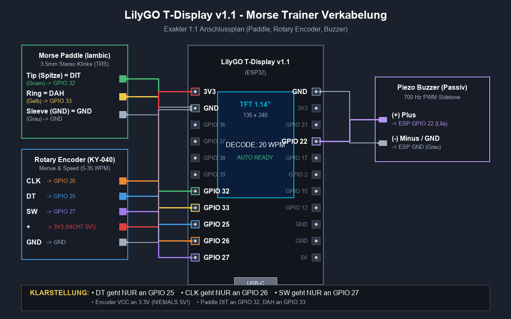

# 📻 ESP32 Iambic Morse Code Trainer & Decoder

**🇬🇧 English** · [🇩🇪 Deutsch](README.de.md)

[](https://github.com/DF3MT/esp32-morse-trainer/actions/workflows/build-and-deploy.yml)
[](https://df3mt.github.io/esp32-morse-trainer/)
[](https://github.com/DF3MT/esp32-morse-trainer/releases/tag/latest)
[](https://www.lilygo.cc/)
[]()
[]()
[](LICENSE)

A standalone **CW Morse code trainer, iambic keyer and real-time decoder** for the **LilyGO T-Display v1.1** (ESP32 with a built-in 1.14" IPS colour display).

It is made for radio amateurs who want to improve their CW up to 40 WPM, and for beginners learning Morse code from scratch with the **Koch method**.

> ⚡ **Install in your browser:** flash the firmware with one click, no software needed: [**DF3MT Web Flasher**](https://df3mt.github.io/esp32-morse-trainer/) (Chrome, Edge or Opera on desktop).

---

## 📚 Documentation

| Document | English | Deutsch |
|---|---|---|
| Overview, features, operation | this file | [README.de.md](README.de.md) |
| Wiring guide | [docs/CABLING_GUIDE.md](docs/CABLING_GUIDE.md) | [docs/CABLING_GUIDE.de.md](docs/CABLING_GUIDE.de.md) |
| Shopping list (parts, AliExpress) | [docs/SHOPPING_LIST.md](docs/SHOPPING_LIST.md) | [docs/SHOPPING_LIST.de.md](docs/SHOPPING_LIST.de.md) |

---

## ✨ Features

* **Iambic keyer (Mode A & Mode B)**
  * Curtis-style timing with squeeze keying (alternating dit-dah).
  * Speed from **3 to 40 WPM** in 1-WPM steps, shown as WPM and CPM (characters per minute = WPM × 5).
  * Optional **auto speed** that follows your keying.
  * Robust paddle-release detection and 5 ms debounce: a single tap never produces a double element.
  * Paddle swap for left-handed operation.
* **Multilingual user interface**
  * Display, menu and web terminal in **German or English**, switchable in the menu (`Sprache / Language`), saved in flash.
  * Built so that more languages can be added easily (see [Adding a language](#-adding-a-language)).
* **Bluetooth LE HID keyboard**
  * The device shows up as a wireless keyboard named **`CW-Keyer DF3MT`** on Windows, macOS, Linux, iOS and Android, no driver needed.
  * Decoded characters, prosigns (e.g. `<SK>`, `<AR>`, `<BT>`) and word spaces are typed live into any text editor, browser, logging program (N1MM, Log4OM) or chat.
  * **German QWERTZ and US QWERTY layouts**: special characters such as `@`, `/`, `?`, `=`, `-` and `Y`/`Z` come out right on both host layouts.
  * `[BLE]` badge in the status bar (dim = waiting for a host, blue = connected).
  * Pairings can be cleared from the menu.
* **Wi-Fi live terminal**
  * The device opens its own access point **`DF3MT-MorseTrainer`** (no password).
  * Open **http://192.168.4.1** or **http://df3mt.local** to see the decoded text live in the browser, with speed, statistics, optional sidetone, copy and TXT download.
  * The web terminal follows the language set on the device.
* **3-line rolling decoder**
  * Covers **A–Z, 0–9, punctuation** (`. , ? / = - : ; ( ) ' " @ + _`) and **prosigns sent without a gap** (`<SK> <AR> <BT> <AS> <KN> <KA> <BK> <VE> <HH> <SOS>`).
  * Tolerant matching of trailing squeeze elements so that `.`, `,`, `=`/`<BT>` and prosigns decode reliably even in Mode B.
  * Automatic word-space detection (5 T threshold), line wrap and upward scrolling.
* **Training mode**
  * **Koch method** with 40 lessons: `K M R S U A P T L O N W J E F 0 Y , V G 5 / Q 9 Z H 3 8 B ? 4 2 7 C 1 D 6 X`.
  * Further sets: letters A–Z, digits 0–9, all characters, **Q codes** (`QTH QSL QSO QRP QRZ QRM QRN QSY QRQ QRS`), **QSO abbreviations** (`CQ 73 5NN GM GA GE GN PSE TNX RST NAME HW? WX RIG ANT FB RPT AGN CUL BCNU SKED ES DE K BK`) and **prosigns**.
  * Shows the target with its Morse pattern and gives immediate feedback (correct / wrong).
* **Boot splash screen** with callsign **DF3MT**, website and repository link. Waits until you press the knob or a paddle.
* **Deep sleep**
  * Goes into ESP32 deep sleep after a configurable time without activity (`Off`, `1`, `2`, `5`, `10 min`; default 2 min).
  * Display controller and backlight are switched off.
  * Wake up by pressing the knob (GPIO 27), with a short wake-up beep.
* **Sidetone**
  * **400 to 2,500 Hz** in 50 Hz steps, volume 0–100 %.
  * Optional **BTL push-pull output** on GPIO 22 + GPIO 21: about 4× the acoustic power (+6 dB) without extra parts.
* **Dual-core FreeRTOS design**
  * **Core 0**: 1 ms timing loop for paddles, keyer and decoder.
  * **Core 1**: display (double-buffered full-screen sprite), menu, Bluetooth and Wi-Fi.

---

## 🛠️ Hardware

| Part | Notes |
|---|---|
| **LilyGO T-Display v1.1** | ESP32 with 1.14" ST7789 IPS display (135×240), USB-C (CH9102) |
| **Iambic paddle** | Dual-lever paddle with 3.5 mm stereo plug (TRS) |
| **KY-040 rotary encoder** | With push button, powered from **3.3 V** |
| **Passive piezo buzzer** | Or a small speaker with driver stage |

👉 Complete parts list with AliExpress search links: [docs/SHOPPING_LIST.md](docs/SHOPPING_LIST.md)

---

## 🔌 Wiring



| Part | Signal | ESP32 GPIO | Notes |
|---|---|---|---|
| **Rotary encoder** | DT | **GPIO 25** | Phase B (direction) |
| **Rotary encoder** | CLK | **GPIO 26** | Phase A (clock, interrupt) |
| **Rotary encoder** | SW | **GPIO 27** | Push button (menu / select / wake-up) |
| **Rotary encoder** | + / VCC | **3V3** | **3.3 V only**, never 5 V |
| **Rotary encoder** | GND | **GND** | |
| **Paddle** | Tip | **GPIO 32** | Dit contact (`INPUT_PULLUP`, active LOW) |
| **Paddle** | Ring | **GPIO 33** | Dah contact (`INPUT_PULLUP`, active LOW) |
| **Paddle** | Sleeve | **GND** | |
| **Buzzer** | (+) | **GPIO 22** | Sidetone PWM (LEDC channel 2, timer 1) |
| **Buzzer (standard)** | (−) | **GND** | 3.3 V peak-to-peak |
| **Buzzer (4× boost)** | (−) | **GPIO 21** | 6.6 V BTL push-pull (inverted signal) |

📘 Step-by-step instructions, header pinout and speaker driver circuits: [docs/CABLING_GUIDE.md](docs/CABLING_GUIDE.md)

---

## 🚀 Installing the firmware

### Option 1: Web Flasher (easiest)
1. Connect the T-Display with a USB-C **data** cable.
2. Open [df3mt.github.io/esp32-morse-trainer](https://df3mt.github.io/esp32-morse-trainer/) in Chrome, Edge or Opera.
3. Click **INSTALL FIRMWARE** and select the serial port.

If no port shows up on Windows, install the [WCH CH343/CH9102 driver](http://www.wch-ic.com/downloads/CH343SER_EXE.html).

### Option 2: Download the binaries
Every build of `main` is published as the release [**latest**](https://github.com/DF3MT/esp32-morse-trainer/releases/tag/latest). Versioned releases (`v*` tags) are listed under [Releases](https://github.com/DF3MT/esp32-morse-trainer/releases).

| File | Flash offset |
|---|---|
| `merged-firmware.bin` | `0x0` (complete image) |
| `bootloader.bin` | `0x1000` |
| `partitions.bin` | `0x8000` |
| `boot_app0.bin` | `0xe000` |
| `firmware.bin` | `0x10000` |

```bash
esptool.py --chip esp32 write_flash 0x0 merged-firmware.bin
```

### Option 3: Build it yourself (PlatformIO)
Requirements: [VS Code](https://code.visualstudio.com/) with the [PlatformIO extension](https://marketplace.visualstudio.com/items?itemName=platformio.platformio-ide), or PlatformIO Core (`pip install platformio`).

```bash
git clone https://github.com/DF3MT/esp32-morse-trainer.git
cd esp32-morse-trainer
pio run                                   # build
pio run -t upload --upload-port COM13     # flash (adjust the port)
```

Platform and library versions are pinned in `platformio.ini`, so local builds and CI builds are identical.

---

## 📖 Operation

### Main screen (decode mode)
* **Turn the knob**: change speed (3–40 WPM).
* **Click the knob**: open the settings menu.
* **Key with the paddles**: decoded text appears over 3 lines and scrolls up.

### Settings menu
Turn to move, click to toggle or edit, click again to save. All settings are stored in flash.

| # | Menu item (EN / DE) | Values |
|---|---|---|
| 1 | Language / Sprache | `Deutsch`, `English` (switches immediately) |
| 2 | Mode / Betriebsart | Decode, Training |
| 3 | Speed / Tempo | 3–40 WPM |
| 4 | Auto speed / Auto-Tempo | On / Off |
| 5 | Keyer mode / Keyer-Modus | Mode A, Mode B |
| 6 | Paddle swap / Paddle-Tausch | Normal, Swapped |
| 7 | Tone pitch / Tonhöhe | 400–2500 Hz (live preview) |
| 8 | Volume / Lautstärke | 0–100 % |
| 9 | Brightness / Helligkeit | 10–100 % |
| 10 | BLE keyboard / BLE-Tastatur | On / Off |
| 11 | BLE layout / BLE-Layout | `DE (QWERTZ)`, `US (QWERTY)` |
| 12 | BT pairing / BT Paarung | Click = delete all pairings |
| 13 | Wi-Fi SoftAP / WLAN SoftAP | On / Off |
| 14 | Training set / Übungssatz | Koch, A-Z, 0-9, All, Q codes, QSO abbr., Prosigns |
| 15 | Koch level / Koch-Stufe | 1–40 |
| 16 | Auto standby / Auto-Standby | Off, 1, 2, 5, 10 min |
| 17 | < Back / < Zurück | Leave menu |

---

## 🌍 Adding a language

All texts on the display live in one table: [`src/i18n_strings.h`](src/i18n_strings.h). Each row is one text, each column one language.

1. Add a value to `enum class Language` in [`src/i18n.h`](src/i18n.h) (before `COUNT`).
2. Add the language name and its ISO code to `LANGUAGE_NAMES` and `LANGUAGE_CODES` in [`src/i18n.cpp`](src/i18n.cpp).
3. Add a column with the translation to **every** row in `src/i18n_strings.h`. If one is missing, the build fails and names the row.
4. Add the same keys for the web terminal to the `I18N` object in [`src/web_page.h`](src/web_page.h).

Notes: the display fonts only contain ASCII characters, so write umlauts as `ae`, `oe`, `ue`. Texts with placeholders such as `%d` must keep the same placeholders in every language. The new language then appears in the menu automatically.

---

## ⚙️ CI/CD

GitHub Actions ([`.github/workflows/build-and-deploy.yml`](.github/workflows/build-and-deploy.yml)) builds the firmware on **every commit and pull request**:

* **Every build**: binaries are attached to the workflow run as a download.
* **Push to `main`**: the web flasher on GitHub Pages and the [`latest`](https://github.com/DF3MT/esp32-morse-trainer/releases/tag/latest) release are updated.
* **Tag `v*`** (e.g. `v2.2.0`): a versioned release with all binaries is created.

The web flasher shows the version and commit it was built from.

---

## 📁 Project structure

```text
src/
  main.cpp            Setup, FreeRTOS tasks, training logic
  keyer.*             Iambic keyer (Mode A/B, auto speed)
  decoder.*           Morse decoder and prosigns
  display.*           TFT screens (splash, decode, training, menu, standby)
  menu.*              Rotary encoder menu and settings (NVS)
  i18n.* i18n_strings.h   UI languages
  sidetone.*          Sidetone (LEDC PWM, BTL)
  ble_manager.*       Bluetooth LE HID keyboard
  web_manager.* web_page.h  Wi-Fi access point and live web terminal
include/config.h      Pins and default values
docs/                 Web flasher, wiring guide, shopping list, diagrams
```

---

## 📄 License

[MIT License](LICENSE): free for personal, educational and amateur radio use.

73 de **DF3MT** · [df3mt.de](https://df3mt.de)
