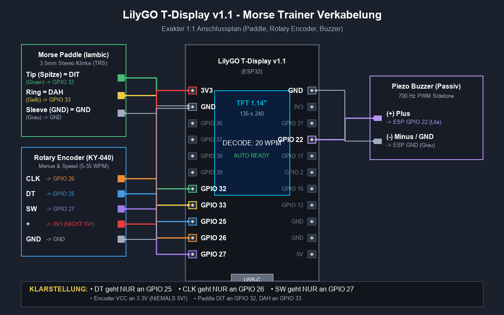
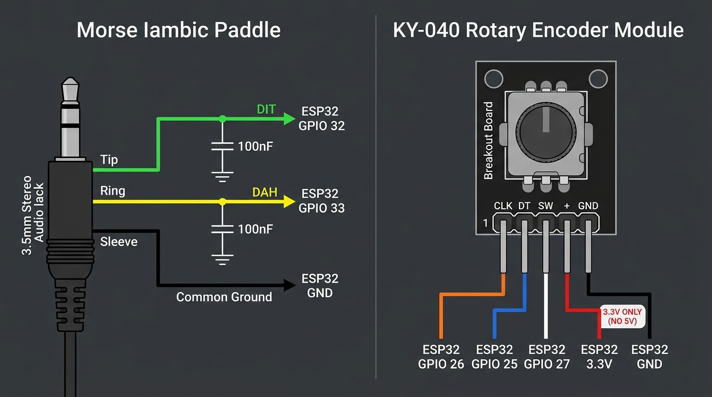

# 🔌 Verkabelungsanleitung: ESP32 Morse-Trainer

[🇬🇧 English](CABLING_GUIDE.md) · **🇩🇪 Deutsch** · [⬅ Zurück zum README](../README.de.md) · [🛒 Einkaufsliste](SHOPPING_LIST.de.md)

> **Wichtiger Hinweis zum Anschlussplan:**
> Dieses Dokument enthält die verbindliche 1:1 Anschlussbelegung für das **LilyGO T-Display v1.1** (ESP32-D0WDQ6-V3 mit integriertem ST7789 1.14" IPS-Farbdisplay), einen **KY-040 Drehencoder mit Taster**, ein **Iambic Morse Paddle (3,5mm Stereo-Klinke)** und den **Audio-Ausgang (Piezo / Mini-Lautsprecher)**.

---

## 1. Verbindliche Systemverkabelung (1:1 Schaltplan)



---

## 2. Lückenlose 1:1 Anschlusstabelle

Jede Leitung geht an **genau einen einzigen Pin** am ESP32:

| Bauteil | Signal am Bauteil | Funktion | ESP32 Pin | Kabelfarbe im Plan | Wichtige Hinweise |
|---|---|---|---|---|---|
| **Rotary Encoder** | **DT** | Phase B (Richtung) | **GPIO 25** | 🔵 Blau | **NUR an GPIO 25!** Keine Verzweigung. |
| **Rotary Encoder** | **CLK** | Phase A (Takt) | **GPIO 26** | 🟠 Orange | **NUR an GPIO 26!** Interrupt-Eingang. |
| **Rotary Encoder** | **SW** | Taster (Menü) | **GPIO 27** | 🟣 Lila | **NUR an GPIO 27!** (Kommt nur 1× auf dem Board vor). |
| **Rotary Encoder** | **+ / VCC** | Betriebsspannung | **3V3** | 🔴 Rot | **3.3V ONLY!** NIEMALS an 5V anschließen! |
| **Rotary Encoder** | **GND** | Masse | **GND** | ⚪ Grau | Gemeinsame Masse. |
| **Morse Paddle** | **Tip (Spitze)** | DIT (Punkt / Links) | **GPIO 32** | 🟢 Grün | 3.5mm Stereo Klinke (aktiver LOW Pullup). |
| **Morse Paddle** | **Ring** | DAH (Strich / Rechts)| **GPIO 33** | 🟡 Gelb | 3.5mm Stereo Klinke (aktiver LOW Pullup). |
| **Morse Paddle** | **Sleeve (Schaft)**| Gemeinsame Masse | **GND** | ⚪ Grau | Gemeinsame Masse. |
| **Piezo Buzzer** | **(+) Plus** | Sidetone Signal A | **GPIO 22** | 🟪 Helllila | PWM Sidetone (LEDC Kanal 2, Timer 1). |
| **Piezo Buzzer** | **(-) Minus (Option 1: Standard)** | Masse | **GND** | ⚪ Grau | 3,3V Peak-to-Peak (Standardlautstärke). |
| **Piezo Buzzer** | **(-) Minus (Option 2: 4× Power Boost)** | Sidetone Signal B (Invertiert) | **GPIO 21** | 🟪 Lila | **6,6V BTL Push-Pull!** 4× akustische Leistung (+6 dB) ohne Zusatzteile! |

### Paddle 3,5 mm Klinkenstecker (TRS Stereo) Belegung:



---

## 3. LilyGO T-Display v1.1 Header-Belegung (Blick von oben auf das Display)

```text
               [ LILYGO T-DISPLAY v1.1 ]
              [ 1.14" IPS TFT DISPLAY ]

     LINKER HEADER PIN-LEISTE          RECHTER HEADER PIN-LEISTE
    +------------------------+        +------------------------+
    | [ ] 3V3  (Encoder VCC) |        | [ ] GND  (Gemeinsame Masse)
    | [ ] GND  (Encoder GND) |        | [ ] 3V3                |
    | [ ] GPIO 36 (VP)       |        | [ ] GPIO 21 (Buzzer - / BTL Boost)
    | [ ] GPIO 37            |        | [ ] GPIO 22 (Buzzer + / Signal)
    | [ ] GPIO 38            |        | [ ] GPIO 17            |
    | [ ] GPIO 39 (VN)       |        | [ ] GPIO 2             |
    | [ ] GPIO 32 (Paddle DIT|        | [ ] GPIO 15            |
    | [ ] GPIO 33 (Paddle DAH|        | [ ] GPIO 12            |
    | [ ] GPIO 25 (Enc DT)   |        | [ ] GND                |
    | [ ] GPIO 26 (Enc CLK)  |        | [ ] GND                |
    | [ ] GPIO 27 (Enc SW)   |        | [ ] 5V   (USB Power)   |
    +------------------------+        +------------------------+
               | USB-C |
```

---

## 4. Audio-Wiedergabe: Piezo vs. Dynamischer Lautsprecher

### A. Passiver Piezo-Summer (Empfohlen für Direktanschluss)
* **Wirkungsweise**: Spannungsgesteuert, kapazitiv (benötigt fast keinen Strom).
* **Maximale Lautstärke**:
  1. **Frequenz**: Im Menü die Tonhöhe auf die Eigenresonanz des Piezos einstellen (meist **1.800 Hz bis 2.400 Hz** $\rightarrow$ bis zu +20 dB lauter als bei 700 Hz!).
  2. **BTL Push-Pull**: Minuspol von `GND` auf den Nachbarpin **`GPIO 21`** umstecken $\rightarrow$ 6,6V Peak-to-Peak (+6 dB Leistungsgewinn).

### B. Dynamischer Mini-Lautsprecher (8 $\Omega$ oder 16 $\Omega$)
* **Wirkungsweise**: Stromgesteuert ($I = U/R$).
* ⚠️ **Achtung**: Ein 8-$\Omega$-Lautsprecher benötigt bei 3,3V über 400 mA. Ein ESP32-Pin kann aber **maximal 30–40 mA** liefern!
* Wird ein 8-$\Omega$-Lautsprecher direkt an GPIO 22 angeschlossen, bricht das Signal auf ca. 0,5V ein und der Ton ist extrem leise.
* **Treiber-Schaltung für Lautsprecher (5V Power)**:
  ```text
  GPIO 22 ───[ 1 kΩ ]─── Base (Transistor 2N2222 / BC547)
                         Emitter ─── GND
                         Collector ─── Lautsprecher (-)
                                       Lautsprecher (+) ─── 5V (LilyGO 5V Pin)
  ```
  *(Alternativ: PAM8403 Mini-Verstärker-Modul für ca. 1 €).*

---

## 5. Häufige Fehlerquellen & Praxistipps

1. **Encoder dreht verkehrt herum**:
   Falls die WPM-Zahl beim Drehen im Uhrzeigersinn kleiner statt größer wird: einfach **GPIO 25 (DT)** und **GPIO 26 (CLK)** vertauschen.
2. **Entprell-Kondensatoren am Paddle (Optional)**:
   Bei sehr harten mechanischen Kontakten kann je ein 100 nF Keramikkondensator zwischen **GPIO 32 und GND** sowie **GPIO 33 und GND** angelötet werden.
3. **Masse-Leitungen**:
   Paddle-Schaft, Piezo-Minus (bei Standardanschluss) und Encoder-GND können problemlos auf einer gemeinsamen Masse-Leiste zusammengefasst werden.
