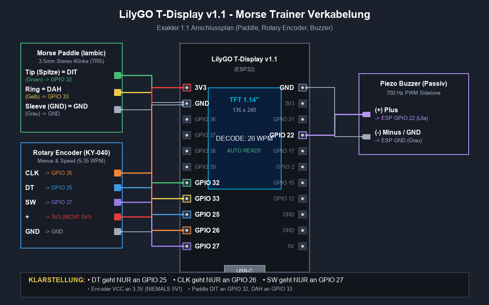
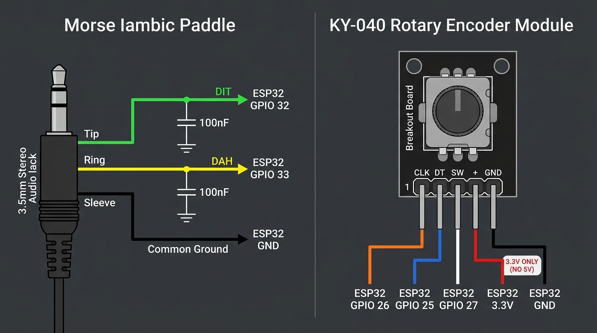

# 🔌 Wiring Guide: ESP32 Morse Trainer

**🇬🇧 English** · [🇩🇪 Deutsch](CABLING_GUIDE.de.md) · [⬅ Back to README](../README.md) · [🛒 Shopping list](SHOPPING_LIST.md)

> **About this wiring plan:**
> This document is the authoritative pin-by-pin wiring for the **LilyGO T-Display v1.1** (ESP32-D0WDQ6-V3 with a built-in 1.14" ST7789 IPS colour display), a **KY-040 rotary encoder with push button**, an **iambic Morse paddle (3.5 mm stereo jack)** and the **audio output (piezo / small speaker)**.

---

## 1. System wiring (schematic)



---

## 2. Complete connection table

Each wire goes to **exactly one pin** on the ESP32:

| Part | Signal on part | Function | ESP32 pin | Wire colour in diagram | Important notes |
|---|---|---|---|---|---|
| **Rotary encoder** | **DT** | Phase B (direction) | **GPIO 25** | 🔵 Blue | **GPIO 25 only!** No branching. |
| **Rotary encoder** | **CLK** | Phase A (clock) | **GPIO 26** | 🟠 Orange | **GPIO 26 only!** Interrupt input. |
| **Rotary encoder** | **SW** | Push button (menu) | **GPIO 27** | 🟣 Purple | **GPIO 27 only!** Also wakes the device from deep sleep. |
| **Rotary encoder** | **+ / VCC** | Supply voltage | **3V3** | 🔴 Red | **3.3 V ONLY!** Never connect to 5 V! |
| **Rotary encoder** | **GND** | Ground | **GND** | ⚪ Grey | Common ground. |
| **Morse paddle** | **Tip** | DIT (dot / left) | **GPIO 32** | 🟢 Green | 3.5 mm stereo jack (pull-up, active LOW). |
| **Morse paddle** | **Ring** | DAH (dash / right) | **GPIO 33** | 🟡 Yellow | 3.5 mm stereo jack (pull-up, active LOW). |
| **Morse paddle** | **Sleeve** | Common ground | **GND** | ⚪ Grey | Common ground. |
| **Piezo buzzer** | **(+) Plus** | Sidetone signal A | **GPIO 22** | 🟪 Light purple | PWM sidetone (LEDC channel 2, timer 1). |
| **Piezo buzzer** | **(−) Minus (option 1: standard)** | Ground | **GND** | ⚪ Grey | 3.3 V peak-to-peak (normal volume). |
| **Piezo buzzer** | **(−) Minus (option 2: 4× power boost)** | Sidetone signal B (inverted) | **GPIO 21** | 🟪 Purple | **6.6 V BTL push-pull!** 4× acoustic power (+6 dB) with no extra parts. |

### Paddle 3.5 mm plug (TRS stereo) pinout



---

## 3. LilyGO T-Display v1.1 header pinout (top view, display facing you)

```text
               [ LILYGO T-DISPLAY v1.1 ]
              [ 1.14" IPS TFT DISPLAY ]

        LEFT PIN HEADER                    RIGHT PIN HEADER
    +------------------------+        +------------------------+
    | [ ] 3V3  (Encoder VCC) |        | [ ] GND  (common ground)
    | [ ] GND  (Encoder GND) |        | [ ] 3V3                |
    | [ ] GPIO 36 (VP)       |        | [ ] GPIO 21 (Buzzer - / BTL boost)
    | [ ] GPIO 37            |        | [ ] GPIO 22 (Buzzer + / signal)
    | [ ] GPIO 38            |        | [ ] GPIO 17            |
    | [ ] GPIO 39 (VN)       |        | [ ] GPIO 2             |
    | [ ] GPIO 32 (Paddle DIT|        | [ ] GPIO 15            |
    | [ ] GPIO 33 (Paddle DAH|        | [ ] GPIO 12            |
    | [ ] GPIO 25 (Enc DT)   |        | [ ] GND                |
    | [ ] GPIO 26 (Enc CLK)  |        | [ ] GND                |
    | [ ] GPIO 27 (Enc SW)   |        | [ ] 5V   (USB power)   |
    +------------------------+        +------------------------+
               | USB-C |
```

---

## 4. Audio output: piezo vs. dynamic speaker

### A. Passive piezo buzzer (recommended for direct connection)
* **How it works**: voltage-driven and capacitive, it draws almost no current.
* **Maximum volume**:
  1. **Frequency**: set the tone pitch in the menu to the piezo's resonant frequency (usually **1,800 Hz to 2,400 Hz**, up to +20 dB louder than at 700 Hz).
  2. **BTL push-pull**: move the minus lead from `GND` to the neighbouring pin **`GPIO 21`** for 6.6 V peak-to-peak (+6 dB more power).
* Use a **passive** buzzer. An active buzzer has its own oscillator and ignores the tone pitch setting.

### B. Small dynamic speaker (8 Ω or 16 Ω)
* **How it works**: current-driven (I = U/R).
* ⚠️ **Caution**: an 8 Ω speaker needs more than 400 mA at 3.3 V, but an ESP32 pin can deliver **30–40 mA at most**.
* If an 8 Ω speaker is connected directly to GPIO 22, the signal collapses to about 0.5 V and the tone is very quiet.
* **Speaker driver circuit (5 V supply)**:
  ```text
  GPIO 22 ───[ 1 kΩ ]─── Base (transistor 2N2222 / BC547)
                         Emitter ─── GND
                         Collector ─── Speaker (-)
                                       Speaker (+) ─── 5V (LilyGO 5V pin)
  ```
  *(Alternative: a PAM8403 mini amplifier module for about 1 €.)*

---

## 5. Common mistakes and practical tips

1. **Encoder turns the wrong way**:
   If the WPM value goes down when you turn clockwise, swap **GPIO 25 (DT)** and **GPIO 26 (CLK)**.
2. **Debounce capacitors on the paddle (optional)**:
   With very hard mechanical contacts, solder a 100 nF ceramic capacitor between **GPIO 32 and GND** and another between **GPIO 33 and GND**.
3. **Ground wires**:
   Paddle sleeve, piezo minus (standard connection) and encoder GND can all share one common ground rail.
